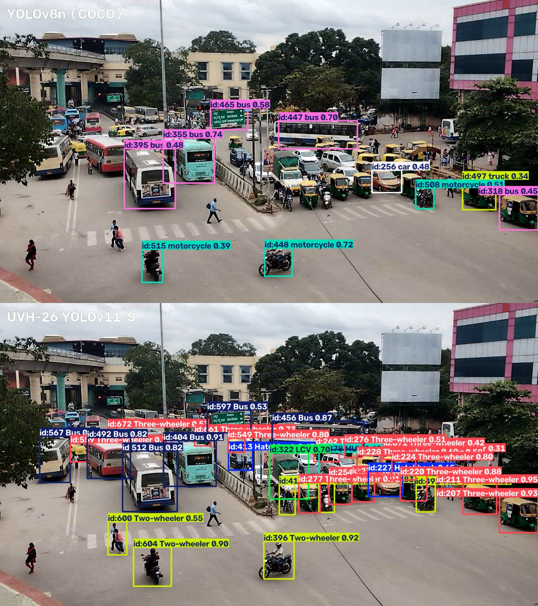
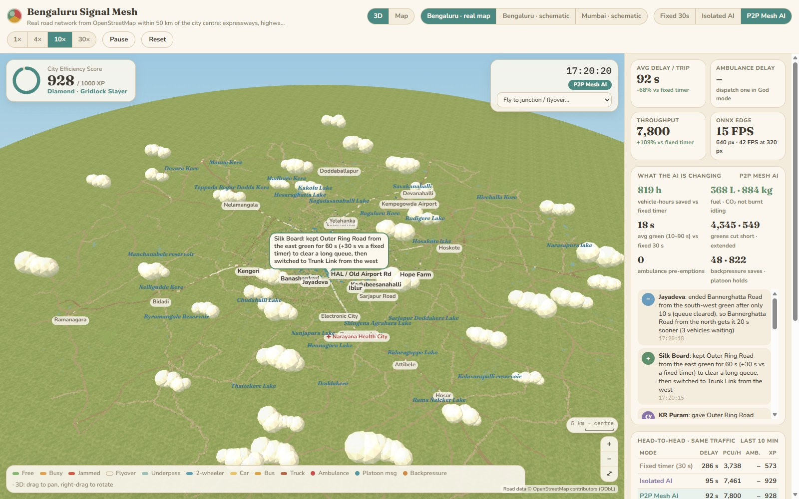
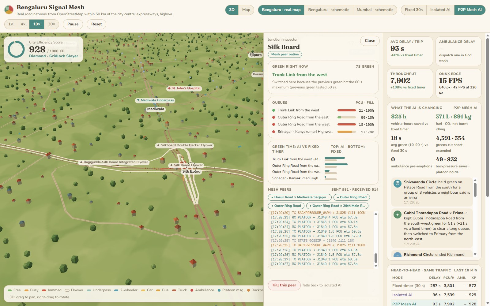
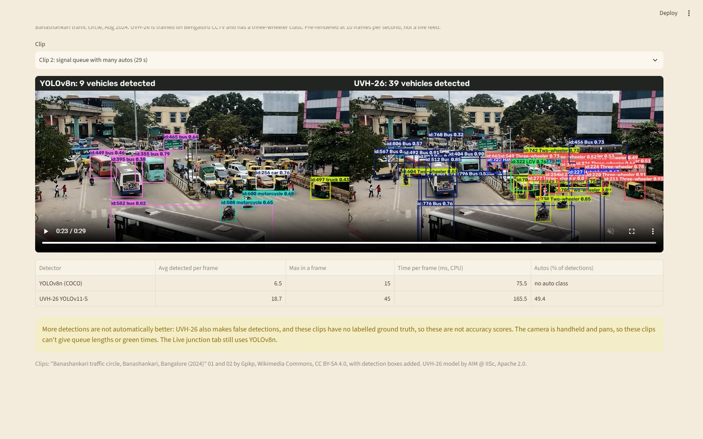

# 🚦 Smart Traffic Signal Optimisation

**Neural Storm 2026 · Track: Future Tech · Problem statement FT-01**

> Develop a real-time AI system that dynamically adjusts traffic signal timings using live
> video feeds and edge ML to reduce urban congestion.

**Team:** Solo entry · **Member:** Samarth G · **Email:** samarthgsura@gmail.com
**College:** Jawaharlal Nehru College of Engineering · **Department:** AIML

---

## Problem

Most Indian junctions still run fixed timers: every approach gets the same green whether
it has 40 vehicles waiting or none. Green time is wasted on empty roads while queues grow
elsewhere, and ambulances wait in line with everyone else.

## Our approach

```
Camera feed ─► YOLOv8n detection ─► ByteTrack tracking ─► per-approach zone counts (PCU)
           ─► adaptive signal controller ─► phase timing output ─► dashboard
```

1. **Detection & tracking.** YOLOv8n (pretrained on COCO) finds cars, two-wheelers,
   buses, trucks and bicycles. ByteTrack gives each vehicle an ID so it is counted once.
   A CLAHE low-light step switches on automatically for dark (night) frames.
2. **Queue estimation in PCU.** Each approach has a polygon zone. Vehicles are converted
   to Passenger Car Units (IRC:106 style: bus = 3, car = 1, two-wheeler = 0.5), because a
   bus needs far more green time than a scooter.
3. **Adaptive controller** (`traffic/optimizer.py`), rules in priority order:
   - minimum green 10 s and 5 s amber + all-red between phases (safety, pedestrians)
   - **ambulance priority**: a red approach with an ambulance gets the next green
   - **no starvation**: no approach waits more than 120 s
   - maximum green 60 s
   - **gap-out**: when the current queue clears, hand over to the approach under most pressure
   - hand over early if another queue is much larger
4. **Evaluation.** The same random traffic is run through three policies:
   a 30 s **fixed timer**, a **Webster pre-timed** plan (the textbook optimal fixed plan),
   and our **AI adaptive** controller. Checked in our fast queue simulator and in **SUMO**.
5. **Edge deployment.** The detector is exported to **ONNX** and benchmarked on CPU only.

## City-scale P2P signal mesh

One smart junction helps; a city of them helps more if they talk to each other. The
**City Command Center** tab scales the same controller up to whole road networks.

**Real Bengaluru map (default).** The full congestion-relevant road network within **50 km of
the city centre**, built from **OpenStreetMap** (Google Maps data can't be extracted under its
terms; OSM is open, ODbL-licensed, and tags lanes, one-ways, signals, bridges and tunnels):

| | |
|---|---|
| Road classes | expressways, NH/SH trunk roads, arterial (primary) and sub-arterial (secondary) roads, plus all their ramps |
| Network | 563 signalised junctions (from real OSM `traffic_signals`), 1,813 unsignalised junctions, 5,410 directed links, ~3,300 km of road |
| Grade separation | 559 flyover links and 89 underpass links, e.g. Hebbal, Silk Board double-decker, Electronic City elevated, Tin Factory, KR Puram flyovers; Madiwala, Kuvempu, Tagore Circle, KR Circle underpasses. A flyover never connects to the signal it passes over. |
| Trips | 32 real hubs (Majestic, Whitefield, Electronic City, Manyata, ORR, airport, Peenya, Hosur…), 15 highway entry points at the 50 km edge, 6 hospitals as ambulance destinations; 45,000 vehicles/hour from a gravity model (illustrative, not measured counts) |

Rebuild it yourself with `python scripts/fetch_osm.py` (≈1 min download) and
`python scripts/build_osm_city.py` (≈2 s). The build merges each multi-node OSM intersection
into one junction (same level only), removes pass-through points, keeps the largest strongly
connected network, marks junctions with a real signal, and names them after landmarks
(Silk Board, Hebbal, Tin Factory, Agara, Sony World…).

The map is pan/zoom: at city scale it shows a live traffic heat layer (free / busy / jammed)
and ambulance beacons; zoom in and individual vehicles, lane queues and signal heads appear.
Unsignalised junctions let each approach flow at its saturation rate while the next road has
room; mesh packets hop across them to the next signal on a vehicle's route.

**3D diorama view (default).** The city is rendered in Three.js as a hand-painted, Ghibli-style
diorama: painted grass, Bengaluru's real lakes and parks (`scripts/fetch_osm_scenery.py`),
faceted trees, little red-roofed houses, drifting clouds and a warm haze. Flyovers are raised on
pillars with ramps, so you can see traffic crossing *over* Silk Board or Hebbal instead of
stopping at their signals. Roads are tinted by congestion; zoom in to see every vehicle, signal
lamp and queue. Drag to pan, right-drag (or Shift-drag) to rotate and tilt, scroll to zoom, and
use **Fly to** for famous junctions and flyovers. A flat **Map** view is one click away.
Three.js is bundled into the page (`traffic/web/vendor/three.min.js`), so it works offline.

**What the AI is changing.** Every signal decision records the rule behind it, and the panel
explains the most interesting ones in plain English, also as speech bubbles on the map, e.g.
*"Silk Board: kept Outer Ring Road from the east green for 60 s (+30 s vs a fixed timer) to
clear a long queue"*, *"BEL Circle: ended Kuvempu Underpass green after only 10 s (queue
cleared), so the west approach gets it 20 s sooner"*, or *"stopped sending traffic from
Sarjapur Road because the road ahead is nearly full"*. City totals show vehicle-hours, fuel and
CO₂ saved against the fixed timer, average green length vs 30 s, and how many greens were cut
short or extended, ambulance pre-emptions, backpressure saves and platoon holds. The junction
inspector shows why the current green is on and how the AI shares green time between
approaches compared with the fixed timer's equal turns.

**Schematic presets** (`traffic/city_graph.py`, small layouts, distances compressed):

- **Bengaluru (radial + IT corridor).** 8 junctions: Hebbal, MG Road, Tin Factory, KR Puram,
  Domlur, Marathahalli, Bellandur, Silk Board. Radial roads into the CBD crossed by the Outer
  Ring Road. Silk Board, KR Puram and Marathahalli are merging chokepoints. The rush button
  doubles the evening outflow from Electronic City, Whitefield and Sarjapur IT parks.
- **Mumbai (linear spine).** 8 junctions down the Western Express Highway (Andheri, Vile Parle,
  Kalanagar, Mahim, Dadar TT) plus Bandra Reclamation and Worli on the Sea Link, with
  narrow single-lane east-west connectors to Sion and JVLR. Base traffic is a southbound
  morning tide; the rush button adds the evening outflow from BKC and South Mumbai.

**Peer-to-peer mesh** (`traffic/p2p_mesh.py`). Every signal is an autonomous peer that only
talks to the junctions it shares a road with. There is no central server to fail.

| Packet | When | What the receiver does |
|---|---|---|
| `STATE_GOSSIP` | every 5 s | Learns how full each of its downstream roads is |
| `PLATOON` `{sender_id, target_id, platoon_pcu, eta_seconds}` | a green releases vehicles toward a neighbour | Counts the platoon as demand before it arrives |
| `BACKPRESSURE_WARN` | an approach is over 80% full | Upstream stops feeding that road: traffic heading into it is discounted, and a green whose traffic can't move is handed over |
| `PRIORITY_CORRIDOR` `{is_emergency, eta_seconds}` | an ambulance is detected | Forwarded hop by hop along its route; each signal turns green ~20 s before it arrives |

If a peer is killed it falls back to isolated AI (or a fixed timer) and its neighbours
simply stop hearing from it.

**Simulation** (`traffic/city_sim.py`). Mesoscopic, 1-second steps: each road is a queue with
a free-flow travel time, a storage capacity in PCU and a saturation flow per lane. A green
only discharges while the next road has room, so spillback and gridlock spread realistically.
Fixed timer, Isolated AI and P2P Mesh AI all face exactly the same random traffic.

**Command Center UI** (`traffic/web/command_center.html`, embedded in Streamlit). Animated
city map with live signals, colour-coded vehicles, road fill heat strips and packet pulses
along mesh links. City Efficiency Score (0–1000 XP) with rank tiers, live head-to-head of all
three modes, God-mode events (ambulance, rush hour, monsoon waterlogging, kill a peer), and a
peer inspector with queues, neighbours and a live packet terminal. The map runs a JavaScript
port of the Python engine so events react instantly; the two agree closely (see below).

## Results

All numbers below come from running the scripts in this repo.

**0. City networks** (`python scripts/compare.py`): 40 simulated minutes per run, 8 ambulances
per run, on random seeds **not** used when tuning the mesh (5 seeds per schematic city, 2 for
the real map, where each run takes ~20 s).

| City / scenario | Fixed timer delay | Isolated AI delay | P2P Mesh delay | Ambulance delay (fixed → isolated → P2P) |
|---|---|---|---|---|
| **Bengaluru real map, normal** | 623 s | 333 s | **320 s** | 200 → 65 → **35 s** |
| **Bengaluru real map, 6 PM IT rush** | 661 s | 406 s | **384 s** | 217 → 67 → **27 s** |
| **Bengaluru real map, Silk Board peer killed** | 623 s | 333 s | **319 s** | 200 → 65 → **29 s** |
| Bengaluru schematic, normal | 338 s | 93 s | **87 s** | 228 → 43 → **3 s** |
| Bengaluru schematic, 6 PM IT rush | 465 s | 228 s | **209 s** | 236 → 41 → **3 s** |
| Bengaluru schematic, Silk Board peer killed | 338 s | 93 s | **90 s** | 228 → 43 → **6 s** |
| Mumbai schematic, normal | 379 s | 77 s | **70 s** | 194 → 48 → **5 s** |
| Mumbai schematic, 6 PM office rush | 394 s | 119 s | **116 s** | 186 → 46 → **4 s** |
| Mumbai schematic, Kalanagar peer killed | 379 s | 77 s | **72 s** | 194 → 48 → **13 s** |

Delay = extra travel time per trip compared with an empty road. On the real Bengaluru network
P2P cuts delay by 42–49% vs fixed timers and 4–5% vs isolated AI, raises throughput by ~5%
(about 11,100 vs 10,550 PCU/h), and roughly halves ambulance delay. Gains over isolated AI are
modest for everyday traffic; the big wins are emergency vehicles and resilience: with a peer
killed the mesh degrades gracefully instead of failing.

The ambulance corridor is *rolling*: only the next 3 signals ahead of an ambulance are told,
and a lock expires if the ambulance is 30 s late. An earlier version announced the whole route
at once; on long real-map routes that held signals green for minutes ahead of a stuck
ambulance and made things worse, which the benchmark caught.

How the mesh was tuned: an ablation on seeds 0–2 showed the platoon-hold rule rarely fired
and that weighting announced platoons at 0.3 PCU per PCU worked best; the table above uses
seeds 10–14 to check that result holds on unseen traffic. The JavaScript engine behind the
live map gives similar numbers (for example Bengaluru: 380 / 87 / 79 s delay, ambulances
397 / 58 / 7 s).

**1. Junction simulator** (`python scripts/compare.py`): 4-way junction, Indian traffic mix
(50% two-wheelers), demand 700 / 350 / 600 / 250 vehicles/h with a rush-hour peak,
3 ambulances/h. Average over 5 random seeds × 1 hour each, same traffic for every policy.

| Policy | Avg wait | 95th pct wait | Avg queue | Ambulance wait | Idle fuel | CO₂ |
|---|---|---|---|---|---|---|
| Fixed timer (30 s) | 159 s | 562 s | 87 PCU | 69 s | 44.6 L | 107 kg |
| Webster pre-timed | 116 s | 389 s | 62 PCU | 184 s | 32.0 L | 77 kg |
| **AI adaptive** | **46 s** | **108 s** | **23 PCU** | **12 s** | **11.7 L** | **28 kg** |

**AI adaptive cuts average waiting time by 71%** and ambulance waiting by 83% compared
with a fixed timer. It won on all 10 seeds we tested, and stays at least as good as the
fixed timer even in gridlock (1,200 vehicles/h on every approach).

**2. SUMO validation** (`python scripts/sumo_compare.py`): the same controller code driving a
SUMO junction (2 lanes per approach, left-hand traffic), 1,908 vehicles over 1 hour.

| Policy | Avg wait | 95th pct wait | Ambulance wait |
|---|---|---|---|
| Fixed timer (30 s) | 76.9 s | 198 s | 70.0 s |
| Webster pre-timed | 35.8 s | 83 s | 42.0 s |
| **AI adaptive** | **35.5 s** | **75 s** | **0.2 s** |

In SUMO the adaptive controller cuts average waiting by 54% vs the fixed timer. It roughly
matches Webster on the average, but Webster has to be told the traffic demand in advance;
the adaptive controller reads it live from the camera, has a shorter worst-case wait, and
lets ambulances through almost without stopping.

**3. Edge inference** (`python scripts/export_edge.py`): YOLOv8n, CPU only (Intel laptop
CPU, no GPU), median of 40 frames.

| Input size | PyTorch | ONNX Runtime | ONNX FPS |
|---|---|---|---|
| 640 px | 92 ms | 67 ms | 15 |
| 416 px | 57 ms | 33 ms | 30 |
| 320 px | 45 ms | 24 ms | 42 |

A signal controller needs only 1–2 decisions per second, so even 640 px on a plain CPU
leaves plenty of headroom for a low-cost edge box.

### Real Bengaluru footage: Banashankari traffic circle

We compared YOLOv8n (COCO classes) with [UVH-26 YOLOv11-S](https://huggingface.co/iisc-aim/UVH-26)
from IISc, which is trained on Bengaluru CCTV and has a three-wheeler class. Both ran on two real
clips (22 s and 29 s, 1080p, every 3rd frame, 640 px input, confidence 0.3, CPU). The clips are
handheld and pan around the circle, so fixed approach zones, queue lengths and green times would
not be valid. These numbers describe detector behaviour only, not traffic flow.

| Clip | Detector | Avg detected per frame | Max | Detections by class | Median time per frame |
|---|---|---|---|---|---|
| Clip 1 | YOLOv8n | 4.1 | 10 | bus 75%, car 23%, motorcycle 1.5%, truck 0.2% | 52 ms |
| Clip 1 | UVH-26 | 8.4 | 16 | bus 55%, auto 23%, motorcycle 13%, car 8%, LCV 2% | 158 ms |
| Clip 2 | YOLOv8n | 6.5 | 15 | bus 42%, truck 26%, car 20%, motorcycle 13% | 76 ms |
| Clip 2 | UVH-26 | 18.7 | 45 | auto 49%, motorcycle 20%, bus 19%, car 8%, LCV 3%, truck 1% | 166 ms |

More detections are not automatically better, because they can include false positives. There is
no labelled ground truth for these clips, so these are not accuracy scores.



**What we found by inspecting 3 sample frames by eye (not a formal accuracy test):**

- **YOLOv8n badly undercounts dense queues.** In the frame above it draws 12 boxes (one is a road
  sign labelled "bus") while roughly 40 or more vehicles are visible. UVH-26 picks up far more of
  the same queue.
- **UVH-26 recognises autorickshaws.** COCO has no auto class, so YOLOv8n labels them "truck" or
  "bus", or misses them. In one sample frame, UVH-26 labelled all 4 autos correctly, while YOLOv8n
  called 2 of them trucks and missed the other 2.
- **UVH-26 still makes mistakes.** It labels pedestrians as a two-wheeler, boxes the same road sign
  as a bus, draws an oversized bus box, calls a small cart a three-wheeler and misses a white SUV
  that YOLOv8n found, so its counts may run high in places.
- **UVH-26 is 2 to 3 times slower** on CPU, at about 6 frames per second. A signal controller needs
  only 1 to 2 decisions per second, so that is still enough.
- **The class shares are not a traffic survey.** They come from under a minute of panning footage
  beside a bus station, and they include these detection errors.

The controllers' benchmark results above come from simulated demand, so they are not affected by
these errors, but a real deployment would be. The dashboard's live detection still uses YOLOv8n;
UVH-26 has only been used in this comparison so far.

*Clips: "Banashankari traffic circle, Banashankari, Bangalore (2024)" 01 and 02 by
[Gpkp](https://commons.wikimedia.org/wiki/User:Gpkp), Wikimedia Commons,
[CC BY-SA 4.0](https://creativecommons.org/licenses/by-sa/4.0). The image above is a frame from
clip 2 with detection boxes added, shared under the same licence. UVH-26 model by AIM @ IISc,
Apache 2.0.*

## What is real in the 3D city

| Element | Source |
|---|---|
| Roads, signals, flyovers, underpasses, lakes, parks | OpenStreetMap |
| Road dropdown ("Watch a road in 3D") | Real road names from OpenStreetMap; the vehicles and counts come from the simulation, not live traffic |
| Buildings, local streets | **Generated**, not real footprints. Density follows the real road network and known districts such as MG Road, Whitefield and Electronic City |
| Vidhana Soudha, UB City, World Trade Center, airport terminal | Simplified shapes at approximate real positions |
| Namma Metro lines and stations | **Approximate** hand-entered positions; `python scripts/fetch_osm_urban.py` replaces them with OpenStreetMap data when Overpass is available. Trains are decorative and not part of the traffic simulation |

## Tech stack

Python 3.13 · Ultralytics YOLOv8n · Supervision (ByteTrack, zones) · OpenCV ·
ONNX / ONNX Runtime · SUMO + TraCI · pandas · Plotly · Streamlit

## Project structure

```
app.py                    Streamlit dashboard
traffic/config.py         PCU values, timing limits
traffic/detector.py       YOLO + ByteTrack + zone counting + night enhancement
traffic/optimizer.py      Fixed, Webster and AI adaptive controllers
traffic/simulator.py      Fast 4-way junction queue simulator
traffic/city_graph.py     Road networks: real Bengaluru (loaded from JSON) + schematic presets
scripts/fetch_osm.py      Download Bengaluru's major roads from OpenStreetMap (Overpass API)
scripts/build_osm_city.py Turn the OSM download into data/cities/bengaluru_osm.json
scripts/fetch_osm_scenery.py  Lakes and parks for the 3D view -> data/cities/bengaluru_scenery.json
scripts/fetch_osm_urban.py    Namma Metro + tall buildings -> data/cities/bengaluru_urban.json
traffic/p2p_mesh.py       Peer-to-peer signal mesh: packets, bus, MeshNode controller
traffic/city_sim.py       Multi-junction simulator: fixed / isolated / P2P modes, events, score
traffic/web/command_center.html  Live canvas Command Center (embedded by app.py)
scripts/download_demo.py  Fetch demo video + YOLOv8n weights
scripts/download_bengaluru.py  Fetch real Bengaluru clips + UVH-26 weights
scripts/analyse_clips.py  Compare YOLOv8n and UVH-26 on the clips -> data/bengaluru_clips.json
scripts/render_clips.py   Side-by-side comparison videos -> data/clip_videos/
scripts/compare.py        City benchmark -> data/city_results.csv (--junction: single junction)
scripts/sumo_compare.py   Same controllers inside SUMO -> data/sumo_results.csv
scripts/export_edge.py    ONNX export + CPU latency benchmark -> data/edge_benchmark.json
data/zones.json           Approach zones (normalised polygons) for the demo video
```

## Setup

```bash
python -m venv .venv
# Windows: .venv\Scripts\activate    macOS/Linux: source .venv/bin/activate
pip install -r requirements.txt
python scripts/download_demo.py      # demo video + model weights
```

## Run

```bash
streamlit run app.py                 # dashboard
python scripts/compare.py            # city benchmark: 2 cities x 3 scenarios x 3 modes (~30 s)
python scripts/compare.py --junction # single-junction benchmark (5 seeds)
pip install -r requirements-sumo.txt # needed once, for the SUMO validation below
python scripts/sumo_compare.py       # SUMO validation (add --gui to watch it)
python scripts/export_edge.py        # ONNX export + CPU benchmark
python scripts/download_bengaluru.py # real Bengaluru clips + UVH-26 weights
python scripts/analyse_clips.py      # YOLOv8n vs UVH-26 on the clips (--coco-only: YOLOv8n only)
python scripts/render_clips.py       # side-by-side videos for the dashboard's Bengaluru clips tab
```

To use your own camera clip, upload it in the dashboard and edit `data/zones.json`:
each zone is a list of `[x, y]` points from 0 to 1 (fractions of frame width/height).

## Screenshots

Figures in these screenshots are live snapshots from one simulated run, so they differ from the
averaged benchmark results above.

**City Command Center:** the real Bengaluru road network in 3D, with the "What the AI is changing" panel.



**Junction inspector at Silk Board:** why the current green is on, queues, AI vs fixed green time and mesh packets.



**Bengaluru clips tab:** YOLOv8n and UVH-26 side by side on real footage (clip credits under Results).



## Limitations and next steps

- One camera view is mapped to approach zones; a real junction would use one camera per
  approach (the code already supports any number of zones).
- The demo video is not an Indian junction. On real Bengaluru footage, YOLOv8n undercounts dense
  queues and mislabels autorickshaws (see Results). UVH-26 looks much better on the same clips, but
  it isn't in the live dashboard yet and hasn't been scored against labelled data.
- The real map's roads, signals, flyovers and underpasses come from OpenStreetMap, but the
  demand is a gravity model between hubs, not measured traffic counts, and signal phasing is
  one approach at a time. The schematic presets also compress distances.
- Tertiary and residential streets are left out on purpose: they rarely carry through
  traffic and would multiply the network size. `fetch_osm.py --tertiary` adds tertiary roads.
- Vehicles follow fixed shortest routes; they don't reroute around a flooded road yet.
- Next: rerouting via the mesh, real camera feeds per approach, and a reinforcement-learning
  policy trained in SUMO, using this controller as the safe fallback.

## AI tools used

This project was built with substantial help from Claude Code, Anthropic's AI coding
assistant (model: Claude Opus 5.5). Claude helped design the architecture and wrote most of
the code and documentation, including the simulator, signal controllers, dashboard, 3D city
view and data scripts, working from Samarth's direction and feedback. All results were
produced by running the code in this repository.
